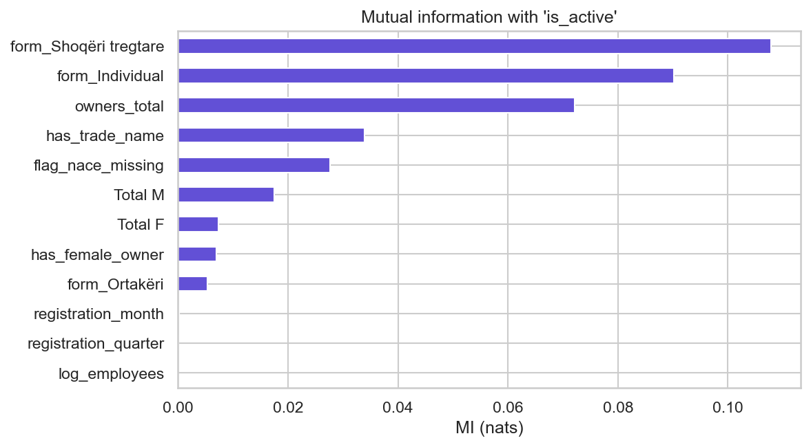
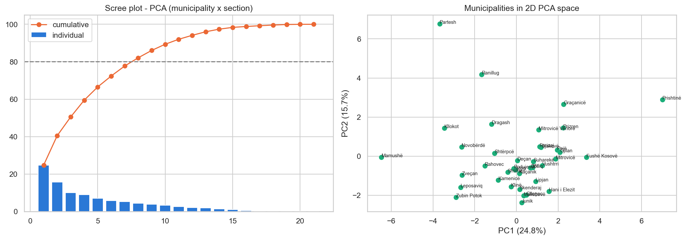

# Registered Businesses in Kosovo (ARBK)

Reproducible data preparation and exploratory analysis of Kosovo's business registry for the **Data Preparation and Visualization** course (Prof. Mërgim Hoti; Asst. Blend Berisha).

The project turns a raw ARBK registry snapshot into an analysis-ready, documented dataset. It audits data quality, resolves duplicate business records, standardizes and enriches fields, evaluates missingness, engineers analytical features, compares sampling methods, and reduces municipality-level sector data with PCA. The checked-in report tables and figures record the results of **Part I: Data Preprocessing**.

## Data

- **ARBK open-data snapshot:** 5 October 2026, 271,967 rows and 15 source columns (`data/raw/Bizneset_2026-10-05.xlsx`). The workbook is stored with Git LFS.
- **Municipal population:** 2024 estimates for Kosovo's 38 municipalities (`data/external/population_municipalities_2024.csv`). These values are used to calculate businesses per 1,000 residents.
- **Reference date:** 5 October 2026, used when deriving business age.

The source data includes business identifiers and names, legal form, NACE Rev. 2 activity and sector, employee and owner counts, municipality, status, registration year/month, and closure date. Original Albanian column names are preserved in the exported clean dataset; derived analytical columns use English names.

## What the pipeline does

Run `python -m part1_preprocessing` to execute the following stages in order:

1. Read the source workbook without allowing automatic type inference to alter IDs or dates.
2. Assign conceptual, measurement, and pandas data types.
3. Audit completeness, uniqueness, validity, and cross-field consistency.
4. Remove the unusable row, resolve duplicate IDs, standardize municipality values, separate embedded status dates, flag conflicts, and split NACE fields into atomic columns.
5. Diagnose missing-data mechanisms and apply field-specific treatments rather than blanket imputation.
6. Join municipality population data and create a reusable NACE dimension table.
7. Engineer status, ownership, time, geography, density, age, and data-quality features.
8. Compare equal-width, quantile, and domain-based discretization.
9. Produce a binary feature matrix.
10. Demonstrate log, min-max, and z-score transformations.
11. Aggregate by municipality, year, sector, and registration period.
12. Compare a simple random 10% sample with a legal-form × status stratified sample.
13. Apply variance filtering and mutual information for feature selection, then PCA to municipality × sector shares.
14. Export the cleaned dataset, dimensions, aggregates, samples, PCA scores, and data dictionary.

Each stage is isolated in `part1_preprocessing/s01_...py` through `s14_...py`. Shared column definitions, constants, paths, and output helpers live in `common/`.

## Outcomes

### Cleaning and data quality

The pipeline produces **271,948 unique business records** from 271,967 source rows. It removes one row with no business ID and consolidates 18 duplicated IDs by retaining the most recent registration record. It also:

- standardizes one municipality value (`Zvecane` → `Zveçan`);
- separates embedded passivation dates from 93,226 status values;
- converts 20 negative employee counts to missing before imputation;
- flags and invalidates 26 closure dates that precede registration;
- retains but flags 2,661 official status/date conflicts; and
- splits 262,263 populated NACE values into code and description fields.

The initial audit shows that most missingness is concentrated in fields where absence has a meaningful interpretation:

| Field | Missing | Interpretation and treatment |
| --- | ---: | --- |
| Closure date | 86.9% | Structural for businesses without a recorded closure; retained for censoring/survival analysis |
| Trade name | 34.4% | Optional field; not imputed, represented by `has_trade_name` |
| NACE activity/sector | 3.6% | Associated with registration year (MAR); assigned an unknown category and a missingness flag |
| Size class | 0.7% | Deterministically recomputed from employee count |
| Employees | 0.6% | Imputed with legal-form median and flagged |
| Municipality | 0.01% (40 rows) | Retained as `E panjohur` for national totals |

The cleaning choices are intentionally conservative: source fields remain available, analytical changes are documented, and imputed or questionable records receive explicit flags.

### Analytical results

- Legal form carries the most mutual information about whether a business is active; owner count and the presence of a trade name are the next strongest retained signals. These are associations, not causal effects.
- Registration month, registration quarter, and log employee count contain little mutual information with active status in the selected sample.
- PCA reduces the **21 sector-share dimensions** for 38 municipalities to **8 components** while retaining at least 80% of variance. PC1 explains 24.8% and PC2 15.7%.
- The municipality map in PCA space reveals distinct sector mixes—especially for Prishtinë and several smaller municipalities—but differences may reflect small denominators or reporting patterns as well as economic structure.
- Per-capita rankings for northern municipalities require caution because low 2024 population estimates can inflate businesses-per-1,000 values.





## Generated deliverables

The repository tracks the compact, report-ready Part I outputs:

| Output | Purpose |
| --- | --- |
| `outputs/part1/01_data_types.csv` | Conceptual, measurement, and implementation types for all source fields |
| `outputs/part1/02_data_quality_report.csv` | Completeness, uniqueness, validity, and consistency findings |
| `outputs/part1/03_missing_value_strategy.csv` | Missingness mechanism, treatment, and rationale by field |
| `outputs/part1/04_cleaning_log.csv` | Every cleaning operation and its affected-row count |
| `outputs/part1/05_data_dictionary.csv` | Source/derived origin, dtype, missing count, and cardinality for 47 exported fields |
| `outputs/part1/fig01_completeness.png` | Missingness before cleaning |
| `outputs/part1/fig02_nace_missingness_mechanism.png` | NACE missingness by registration year and legal form |
| `outputs/part1/fig03_transformations.png` | Comparison of employee-count transformations |
| `outputs/part1/fig04_mutual_information.png` | Feature association with active status |
| `outputs/part1/fig05_pca_municipalities.png` | PCA scree plot and municipality profiles |

Running the pipeline also creates larger intermediate and downstream files under `data/processed/`, including `arbk_clean.csv`, the 10% stratified sample, aggregation tables, the binary matrix, the NACE dimension, and municipality PCA scores. These generated files are intentionally ignored by Git.

## Setup and reproduction

Requirements: **Python 3.10 or newer** and Git LFS.

```bash
git clone https://github.com/olsadomi/PVDh_Gr.2.git
cd PVDh_Gr.2
git lfs pull

python -m venv .venv
# Windows
.venv\Scripts\activate
# macOS/Linux
# source .venv/bin/activate

python -m pip install -r requirements.txt
python -m part1_preprocessing
```

The pipeline uses a fixed random seed (`42`) for sampling and mutual-information estimation. Outputs are written relative to the repository root, so the module should be run from that directory.

## Repository layout

```text
common/                   Shared schema, configuration, constants, and helpers
data/
  external/               Municipality population input
  raw/                    ARBK source workbook (Git LFS)
  processed/              Generated datasets (ignored)
outputs/part1/            Tracked report tables and figures
part1_preprocessing/      Fourteen-stage preprocessing pipeline
requirements.txt          Python dependencies
```

Only Part I is currently implemented and documented in this repository. `outputs/part2/`, `outputs/part3/`, and `powerbi/` are reserved for later analysis and visualization work.


